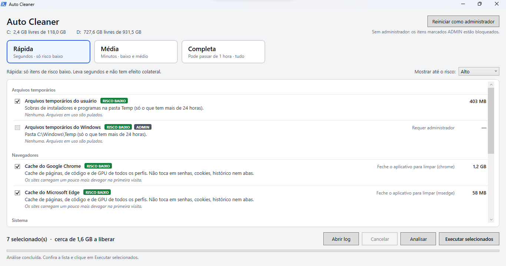

# Auto Cleaner


Ferramenta de limpeza e otimização para **Windows 10/11**, com interface gráfica, feita em PowerShell (WPF). Vai da limpeza básica à avançada, mostra quanto espaço cada item libera antes de apagar e tem um modo de simulação.

*English: a Windows 10/11 cleanup and optimization tool with a graphical interface, written in PowerShell (WPF). It shows how much space each item frees before deleting anything and has a dry-run mode.*



> ⚠️ **Aviso:** o programa apaga arquivos e executa comandos do sistema. Rode primeiro o modo de simulação, leia a descrição de cada item e use por sua conta e risco. Veja a [licença](LICENSE).

## ✨ Funcionalidades

- **Três níveis de limpeza:** rápida, média e completa
- **Filtro por nível de risco** de cada item
- **Análise antes de apagar:** mostra o espaço que cada item libera
- **Modo simulação (`-DryRun`):** escaneia e registra tudo, sem apagar nada nem executar comandos
- **Limpeza de:** arquivos temporários, caches de navegadores (Chrome e Edge), miniaturas, shaders, relatórios de erro do Windows, cache DNS, lixeira, caches de apps (Discord, VS Code, Steam), cache do FiveM, caches de desenvolvimento (npm, pip, uv), downloads do Windows Update, logs antigos
- **Otimizações:** TRIM em SSD, desfragmentação (só em HD), DISM, SFC, hibernação, programas de inicialização
- **Ponto de restauração** opcional, criado antes da execução
- **Log** de cada execução na pasta `logs/`

## 🛡️ Segurança

- Todo caminho passa por uma verificação única antes de qualquer exclusão: só apaga dentro de pastas permitidas e nunca em pastas protegidas (credenciais, dados de login, jogos, etc.)
- **Não segue atalhos/junções** (links simbólicos), evitando apagar fora do alvo
- Só apaga arquivos com mais de 24 horas nas pastas temporárias
- Arquivos em uso são pulados, e apps abertos (como o navegador) têm o cache ignorado
- Os comandos do sistema são fixos no código: o `catalog.json` não consegue injetar comandos
- Programas de inicialização são só desativados (o mesmo recurso do Gerenciador de Tarefas), nunca removidos

## 📋 Requisitos

- Windows 10 ou 11
- Windows PowerShell 5.1 (já vem no Windows)
- Alguns itens precisam de **administrador** (o programa avisa)

## 🚀 Como usar

1. Baixe o ZIP da [última versão](https://github.com/dalmeidasdev/auto-cleaner/releases/latest) (em *Assets*, **Source code (zip)**) e extraia
2. Dê duplo clique em `AutoCleaner.bat`
3. Escolha o nível, clique em **Analisar** e revise os itens
4. Clique em **Executar**

Para simular sem apagar nada, abra o terminal na pasta e rode:

```
AutoCleaner.bat -DryRun
```

> O `.bat` abre o script com `-ExecutionPolicy Bypass` apenas para esta execução, sem alterar a configuração do seu Windows. Confira o código antes de rodar. Ele é curto e está todo neste repositório.

## 🧯 Problemas comuns

- **O Windows avisou sobre o arquivo baixado (SmartScreen).** O programa não é assinado digitalmente. Confira o código e, se confiar, use *Mais informações → Executar assim mesmo*.
- **Alguns itens aparecem bloqueados.** Eles precisam de permissão de administrador: feche o programa e abra de novo como administrador.

## 📁 Estrutura

```
AutoCleaner.bat       # atalho para abrir o programa
AutoCleaner.ps1       # janela, eventos e fluxo principal
catalog.json          # itens de limpeza, textos, pastas permitidas e protegidas
src/
  Engine.ps1          # varredura, exclusão e travas de segurança
  Optimizations.ps1   # DISM, SFC, TRIM, hibernação, inicialização, ponto de restauração
  MainWindow.xaml     # interface principal
  ListDialog.xaml     # janela de listas
```

## 🤖 Uso de IA

Este projeto foi desenvolvido com apoio de IA (Claude). Eu defini a ideia e os requisitos, executei e testei tudo no meu próprio computador e ajustei o que não funcionou.

## 📄 Licença

[MIT](LICENSE) © Diego Almeida
